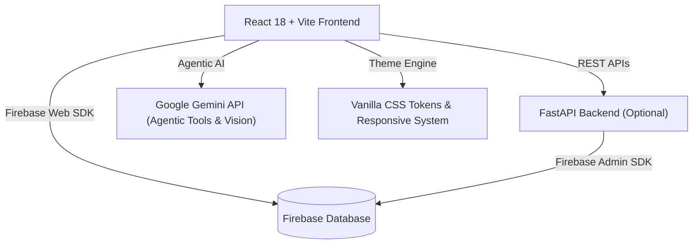

# 🎓 CampusConnect — KL University Centralized Academic Portal

[](https://react.dev/)
[](https://firebase.google.com/)
[](https://fastapi.tiangolo.com/)
[](https://ai.google.dev/)
[](https://vittalkeerthana26-bot.github.io/campusconnect-fb/)
[]()

> **CampusConnect** is a centralized, AI-augmented student and administrative platform developed for **KL University**. It integrates event registrations, student club management, grievance redressal, agentic tool-calling conversational AI, and computer vision-based lost-and-found matching into a responsive dual-portal experience backed by **Firebase**.

🌐 **Live GitHub Pages URL:** [https://vittalkeerthana26-bot.github.io/campusconnect-fb/](https://vittalkeerthana26-bot.github.io/campusconnect-fb/)

---

## 👥 Project Team & Mentorship

- **Project Guide:**
  - **Dr. Rafeeq Mohammed** (Faculty Guide)
- **Team Members:**
  - **Anvith Kumar**
  - **K. Sai Srinath**
  - **Gokul Arnav**
  - **S. Keerthana**
  - **V. Keerthana**

---

## 🌟 Key Features

### 1. 🛡️ Role-Based Dual Portals (Student & Admin)
- **Student Portal:**
  - Register for upcoming campus events and hackathons with real-time capacity counters.
  - Track registered events with timestamps and calendar details in *My Registrations*.
  - File grievance tickets with categories (Hostel, Academics, Mess, Security, Infrastructure) and live resolution tracking.
  - Explore campus clubs and activities.
- **Admin Portal:**
  - Full CRUD operations on university events (create, update schedule, change venue, manage capacities).
  - Inspect student registration rosters per event with attendee details and download counts.
  - Review, categorize, resolve, and publish official responses to student complaints.
  - Moderate Lost & Found inventory and mark items as claimed or returned.

### 2. 🔥 Firebase Cloud Database
- Migrated from PostgreSQL to **Firebase Cloud Database & Realtime Persistence**.
- Real-time event registrations, seat decrementing, and instant status updates.
- All master database records preserved exactly across Users, Clubs, Events, Registrations, Lost & Found, and Grievance tickets.

### 3. 🤖 Agentic AI Campus Assistant (`/chatbot`)
- Powered by **Google Gemini** with structured function calling / tool execution.
- Connected directly to the live Firebase database to:
  - Query upcoming event schedules, locations, and remaining capacities.
  - Lookup active student clubs and their leads.
  - Register authenticated students for events on request through conversational commands.
  - Search lost and found records dynamically.

### 4. 👁️ AI Computer Vision & Semantic Image Search (`/lost-found`)
- Multi-modal visual inspection for lost and found items.
- Extracts visual category hints, dominant colors, and distinguishing item attributes.
- Runs ranked similarity matching against active database records with real-time confidence scores.
- One-click testing with pre-curated campus sample items or custom photo uploads.

### 5. 🎨 Design System & Theme Engine
- **Light Theme:** Warm ivory (`#f7f4ed`), soft neutral surfaces (`#ede8de`), teal (`#0d9488`), and indigo (`#4f46e5`) accents. Zero pure white cards or harsh black boxes.
- **Dark Theme:** Deep slate (`#0b0f19`) with translucent glassmorphic surfaces (`rgba(17, 24, 39, 0.78)`).
- **System Theme:** Automatically adapts to operating system color scheme preferences.
- **Mobile-First Responsive Engine:** Smoothly scales from mobile viewports (360px–430px), tablets (768px), to 4K displays with dedicated slide-out navigation drawer.

---

## 🏗️ System Architecture



---

## 🗂️ Project Structure

```
campusconnect/
├── backend/
│   ├── main.py              # FastAPI application entrypoint & API routes
│   ├── models.py            # Data models (Users, Events, Registrations, etc.)
│   ├── schemas.py           # Pydantic request/response schemas
│   ├── firebase_db.py       # Firebase backend connector & data persistence
│   ├── database.py          # Database session management
│   ├── ai_agent.py          # Gemini AI agent with tool calling & computer vision search
│   ├── seed.py              # Firebase database seeder script
│   └── requirements.txt     # Python dependencies with Firebase
├── database/
│   ├── firebase_data.json   # Exact preserved seed records for Firebase
│   ├── firestore.rules      # Cloud Firestore security rules
│   └── schema.sql           # Database schema reference
├── frontend/
│   ├── src/
│   │   ├── components/      # Navbar, EventCard, ClubCard, EventForm, etc.
│   │   ├── context/         # ThemeContext (Light/Dark/System) & UserContext (Auth)
│   │   ├── pages/           # Dashboard, Events, Clubs, AIChatbot, AIImageSearch, Complaints, ManageEvents
│   │   ├── services/        # Firebase Database service & API client
│   │   ├── index.css        # Centralized theme tokens, utilities & responsive engine
│   │   ├── App.jsx          # Route definitions & application layout
│   │   └── main.jsx         # React root initialization
│   ├── package.json         # Node.js project manifest & scripts
│   └── vite.config.js       # Vite build configuration (base: './' for GitHub Pages)
└── .github/
    └── workflows/
        └── deploy.yml       # GitHub Actions automated deployment to GitHub Pages
```

---

## 🚀 Getting Started

### 1. Frontend Setup (GitHub Pages / Local)

```bash
cd frontend

# Install packages
npm install

# Start Vite development server
npm run dev
```
Frontend application will be accessible at: `http://localhost:5173`

---

### 2. Backend Setup (Optional)

```bash
cd backend

# Create and activate virtual environment
python -m venv .venv
.venv\Scripts\activate

# Install dependencies
pip install -r requirements.txt

# Seed initial Firebase database records
python seed.py

# Start FastAPI server
uvicorn main:app --reload --port 8000
```

---

## 🔑 Demo Access Credentials

The Firebase database comes pre-seeded with instant test credentials:

| Role | Email | Password | Access Scope |
| :--- | :--- | :--- | :--- |
| **Student** | `student@campusconnect.local` | `student123` | Event registration, My Registrations, File Complaints, AI Chatbot |
| **Coordinator** | `coordinator@campusconnect.local` | `coordinator123` | Event Management, Attendee Rosters, Complaints |
| **Administrator** | `admin@campusconnect.local` | `admin123` | Full Event Management (CRUD), Student Rosters, Complaint Resolution |

---

## 📜 Acknowledgements & Academic Notice
Developed for academic presentation and university evaluation at **KL University**. Guided by **Dr. Rafeeq Mohammed**.
